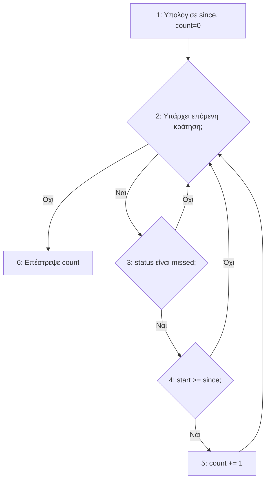
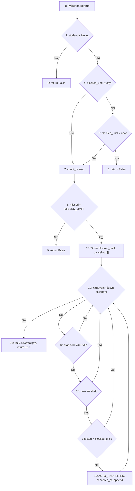
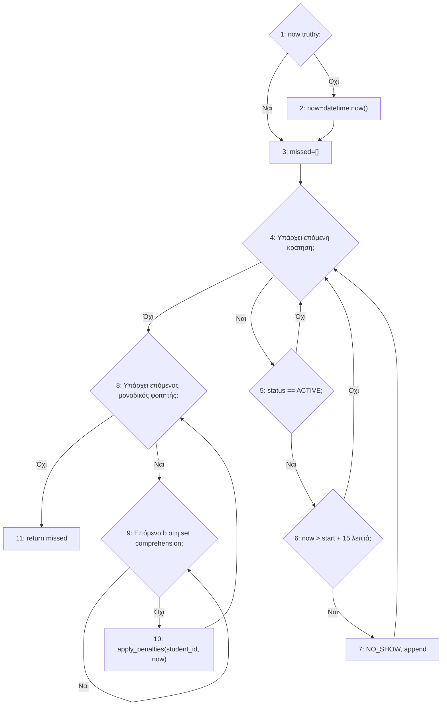
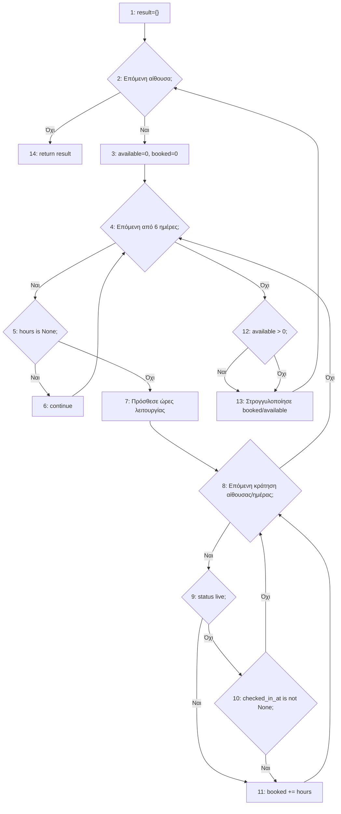
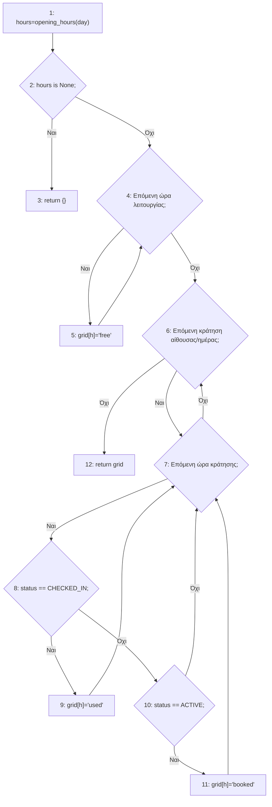
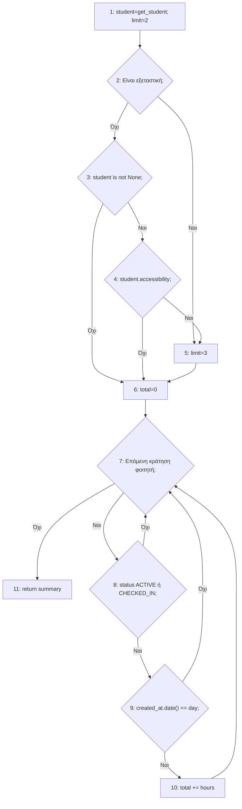

# Εβδομάδα 7 · Προδιαγραφή ελέγχου white-box · StudyRoom

**Ομάδα:** Καλογερόπουλος Ιερόθεος Ορέστης ·  **ΑΜ:** 21098 · **Έκδοση:** w07
**Κώδικας:** StudyRoom 0.1, `main`, commit `1bef50c`
**Βάση ελέγχου:** Κανόνες κρατήσεων ΚΡ1–ΚΡ16· `quality/requirements.md`
**Κατανομή:** Πλήρης
**Περιβάλλον:** seeded δεδομένα από το `tests/conftest.py`. Όλες οι κλήσεις με χρονική παράμετρο περνούν ρητά `now`, τοπική ώρα Ελλάδας χωρίς πληροφορία timezone, όπως το μοντέλο δεδομένων.

## 1. Αντικείμενο και στόχος κάλυψης

Η baseline μέτρηση περιλαμβάνει τα starter tests και τα 75 tests της w06 (79 συλλεγμένα tests, 71 PASS και 8 FAIL). Χρησιμοποιήθηκε `pytest-cov` με `branch = true`.

| Μονάδα                                                          | Κίνδυνος / αιτία επιλογής                                                                                    | Κριτήριο και στόχος                                                                              | Κάλυψη πριν: εντολές / διακλαδώσεις |
| --------------------------------------------------------------------- | --------------------------------------------------------------------------------------------------------------------------------- | ----------------------------------------------------------------------------------------------------------------- | ---------------------------------------------------------------- |
| `penalties.count_missed`                                            | Δίκαιη εφαρμογή του κυλιόμενου παραθύρου· R-07, ΚΡ11                                       | Εντολές, διακλαδώσεις, βασικά μονοπάτια και όριο 30×24 ωρών · 100% |                                                                  |
| `penalties.apply_penalties`                                         | Αποκλεισμός 168 ωρών, ακύρωση μόνο των κατάλληλων ενεργών κρατήσεων· R-07 | Εντολές, διακλαδώσεις και βασικά μονοπάτια· 100%                            |                                                                  |
| `booking.sweep_no_shows`                                            | Ακριβής μετάβαση μετά το +15:00 και ποινή μία φορά ανά φοιτητή· R-07/R-18          | Εντολές και διακλαδώσεις· 100%                                                             |                                                                  |
| `reports.weekly_occupancy`                                          | Ακρίβεια στοιχείων χωρητικότητας για τη βιβλιοθήκη· R-21                            | Εντολές, διακλαδώσεις, καταστάσεις κρατήσεων· 100%                        |                                                                  |
| `reports.hourly_grid`                                               | Ακριβής κατάσταση κάθε ώρας και κενή Κυριακή· R-21                                         | Εντολές, διακλαδώσεις και εμφωλευμένοι βρόχοι· 100%                      |                                                                  |
| `reports.student_day_summary` (προαιρετική μονάδα) | Ορθή ημερήσια χρέωση και μη αρνητικό υπόλοιπο· R-09                                       | Εντολές, διακλαδώσεις και MC/DC· 100%                                                      |                                                                  |

| Συνάρτηση      | Εντολές πριν | Branches πριν |
| ----------------------- | ----------------------: | ----------------: |
| `count_missed`        |              100% (7/7) |       83,3% (5/6) |
| `apply_penalties`     |           87,5% (14/16) |      80,0% (8/10) |
| `sweep_no_shows`      |              100% (9/9) |        100% (6/6) |
| `weekly_occupancy`    |               0% (0/15) |         0% (0/10) |
| `hourly_grid`         |               0% (0/13) |         0% (0/12) |
| `student_day_summary` |               0% (0/10) |          0% (0/8) |

Πηγή baseline: `python -m pytest --cov=studyroom --cov-branch --cov-report=term-missing:skip-covered` πριν από την προσθήκη white-box tests. Τα ποσοστά συνάρτησης είναι από JSON report του coverage.py; `unblock` και `export_week_csv` δεν περιλαμβάνονται στις επιλεγμένες μονάδες.

## 2. Γράφοι ροής ελέγχου

Κάθε ατομική σύγκριση, σκέλος `and`/`or`, όρος chained comparison και έλεγχος βρόχου είναι ξεχωριστός κόμβος. Οι κόμβοι ενεργειών ομαδοποιούν μόνο συνεχόμενες εντολές χωρίς απόφαση.

### 2.1 `count_missed`

| Κόμβος | Γραμμές | Κώδικας / απόφαση                               |
| ------------ | -------------: | ------------------------------------------------------------- |
| 1            |         13–14 | Αρχικοποίηση ορίου και μετρητή     |
| 2            |             15 | Επανάληψη στις κρατήσεις φοιτητή |
| 3            |             16 | `status in MISSED_STATUSES`                                 |
| 4            |             17 | `start >= since`                                            |
| 5            |             18 | Αύξηση μετρητή                                   |
| 6            |             19 | Επιστροφή / έξοδος                             |

### 2.2 `apply_penalties`

| Κόμβος | Γραμμές | Κώδικας / ατομική απόφαση                                   |
| ------------ | -------------: | -------------------------------------------------------------------------------- |
| 1            |             24 | Ανάκτηση φοιτητή                                                  |
| 2–3         |         25–26 | Άγνωστος φοιτητής                                                |
| 4–6         |         27–28 | `blocked_until` truthy και έπειτα `blocked_until > now`             |
| 7–9         |         29–30 | Αριθμός χαμένων μικρότερος από το όριο          |
| 10           |         31–32 | Έναρξη αποκλεισμού και αρχικοποίηση λίστας |
| 11           |             33 | Βρόχος κρατήσεων                                                  |
| 12           |             34 | `status == ACTIVE`                                                             |
| 13           |             34 | `now <= start` (1ο σκέλος chained comparison)                           |
| 14           |             34 | `start < blocked_until` (2ο σκέλος chained comparison)                  |
| 15           |         35–37 | Αυτόματη ακύρωση και προσθήκη στη λίστα        |
| 16           |         38–39 | Ειδοποίηση και επιτυχής επιστροφή                  |

### 2.3 `sweep_no_shows`

| Κόμβος | Γραμμές | Κώδικας / απόφαση                                                                                                                   |
| ------------ | -------------: | ------------------------------------------------------------------------------------------------------------------------------------------------- |
| 1–2         |            136 | `now or datetime.now()`· ο έλεγχος του fallback δεν εκτελείται στα tests, που περνούν ρητό χρόνο |
| 3            |            137 | Αρχικοποίηση λίστας                                                                                                             |
| 4            |            138 | Βρόχος όλων των κρατήσεων                                                                                                   |
| 5            |            139 | `status == ACTIVE`                                                                                                                              |
| 6            |            139 | `now > start + CHECKIN_GRACE_MINUTES`                                                                                                           |
| 7            |       140–141 | Μετάβαση σε `NO_SHOW`, προσθήκη στη λίστα                                                                             |
| 8            |            142 | Βρόχος μοναδικών φοιτητών με χαμένες                                                                              |
| 9            |            142 | Βρόχος set comprehension `b.student_id for b in missed`                                                                                   |
| 10           |            143 | Εφαρμογή ποινής μία φορά ανά φοιτητή                                                                               |
| 11           |            144 | Επιστροφή λίστας                                                                                                                   |

### 2.4 `weekly_occupancy`

| Κόμβος | Γραμμές | Κώδικας / απόφαση                                                                   |
| ------------ | -------------: | ------------------------------------------------------------------------------------------------- |
| 1–3         |         14–17 | Αρχικοποίηση αποτελέσματος και μετρητών ανά αίθουσα |
| 2            |             15 | Βρόχος αιθουσών                                                                     |
| 4            |             18 | Βρόχος έξι ημερών                                                                  |
| 5–6         |         20–22 | `hours is None` και παράλειψη ημέρας                                          |
| 7            |             23 | Άθροιση διαθέσιμων ωρών                                                      |
| 8            |             24 | Βρόχος κρατήσεων αίθουσας/ημέρας                                     |
| 9            |             25 | Κατάσταση ACTIVE ή CHECKED_IN                                                           |
| 10           |             25 | Εναλλακτικός έλεγχος `checked_in_at is not None`                             |
| 11           |             26 | Άθροιση ωρών κράτησης                                                          |
| 12–13       |             27 | Έλεγχος παρονομαστή και ποσοστό με ένα δεκαδικό          |
| 14           |             28 | Επιστροφή                                                                                |

### 2.5 `hourly_grid`

| Κόμβος | Γραμμές | Κώδικας / απόφαση                                                        |
| ------------ | -------------: | -------------------------------------------------------------------------------------- |
| 1–3         |         33–36 | Ωράριο, κλειστή ημέρα, επιστροφή κενού πίνακα    |
| 4–5         |         37–38 | Βρόχος ωρών λειτουργίας και αρχικοποίηση ως free |
| 6            |             39 | Βρόχος κρατήσεων                                                        |
| 7            |             40 | Εμφωλευμένος βρόχος ωρών κράτησης                        |
| 8–9         |         41–42 | Check-in σημαίνει used                                                         |
| 10–11       |         43–44 | ACTIVE σημαίνει booked                                                         |
| 12           |             45 | Επιστροφή grid                                                                |

### 2.6 `student_day_summary`

| Κόμβος | Γραμμές | Κώδικας / απόφαση                                                       |
| ------------ | -------------: | ------------------------------------------------------------------------------------- |
| 1            |         50–51 | Ανάκτηση φοιτητή και προεπιλεγμένο όριο 2          |
| 2            |             52 | Εξεταστική                                                                  |
| 3            |             52 | `student is not None`                                                               |
| 4            |             52 | `student.accessibility`                                                             |
| 5            |             53 | Όριο 3                                                                            |
| 6            |             54 | Αρχικοποίηση συνόλου ωρών                                      |
| 7            |             55 | Βρόχος κρατήσεων                                                       |
| 8            |             56 | ACTIVE ή CHECKED_IN                                                                  |
| 9            |             57 | Ημερομηνία που χρησιμοποιείται από τον κώδικα |
| 10           |             58 | Άθροιση ωρών                                                               |
| 11           |             59 | Σύνοψη και μη αρνητικό υπόλοιπο                            |

## 3. Κυκλωματική πολυπλοκότητα

| Συνάρτηση      | N κόμβοι | E ακμές | `E − N + 2` | Ατομικές αποφάσεις + 1 | radon cc | Διαφορά                                                                                                                                                                              |
| ----------------------- | -------------: | -----------: | -------------: | --------------------------------------: | -------: | ------------------------------------------------------------------------------------------------------------------------------------------------------------------------------------------- |
| `count_missed`        |              6 |            8 |              4 |                               3 + 1 = 4 |    A (4) | Καμία                                                                                                                                                                                  |
| `apply_penalties`     |             16 |           23 |              9 |                               8 + 1 = 9 |    B (8) | Η γραφική ανάλυση χωρίζει τα δύο σκέλη του chained comparison `now <= start < blocked_until`· το radon το μετρά ως μία σύγκριση |
| `sweep_no_shows`      |             11 |           16 |              7 |                               6 + 1 = 7 |    B (7) | Καμία                                                                                                                                                                                  |
| `weekly_occupancy`    |             14 |           20 |              8 |                               7 + 1 = 8 |    B (8) | Καμία                                                                                                                                                                                  |
| `hourly_grid`         |             13 |           18 |              7 |                               6 + 1 = 7 |    B (7) | Καμία                                                                                                                                                                                  |
| `student_day_summary` |             11 |           16 |              7 |                               6 + 1 = 7 |    B (7) | Καμία                                                                                                                                                                                  |

Η εντολή `now = now or datetime.now()` της `sweep_no_shows` έχει δύο ατομικές εξόδους, αλλά η περίπτωση χωρίς συγκεκριμένο `now` αποκλείεται από το εργαστηριακό συμβόλαιο ώστε οι έλεγχοι χρόνου να είναι αναπαραγώγιμοι.

## 4. Βασικά μονοπάτια

Οι είσοδοι που παραλείπουν την ημερομηνία αναφοράς χρησιμοποιούν `now = 2026-11-03 10:00:00`. Τα ιστορικά/μελλοντικά bookings δημιουργούνται απευθείας στο seeded store με αιτιολόγηση στο test, ώστε να ελεγχθούν οι συναρτήσεις χωρίς να περάσουν ξανά από validation.

### `count_missed` · V(G)=4

| Μονοπάτι                               | Κόμβοι              | Εφικτό; / είσοδοι          | Αναμενόμενο από ΚΡ11 | Test               |
| ---------------------------------------------- | ------------------------- | --------------------------------------- | ------------------------------------ | ------------------ |
| C1: κενή λίστα                        | 1-2(0)-6                  | Ναι; κανένα booking            | 0 χαμένες                     | TC-WB-01           |
| C2: κατάσταση μη missed             | 1-2(1)-3(F)-2(0)-6        | Ναι; CANCELLED                       | Δεν μετρά                    | TC-WB-27           |
| C3: χαμένη εντός παραθύρου | 1-2(1)-3(T)-4(T)-5-2(0)-6 | Ναι; NO_SHOW / LATE_CANCEL           | Μετρά μία φορά           | TC-WB-02, TC-WB-27 |
| C4: χαμένη εκτός ορίου         | 1-2(1)-3(T)-4(F)-2(0)-6   | Ναι· start 32 ημέρες πριν | Δεν μετρά                    | TC-WB-24           |

Το ακριβές όριο `now−30 ημέρες−1 δευτερόλεπτο` είναι επίσης εφικτό και αναμενόμενα δεν μετρά, αλλά αποτυγχάνει λόγω INC-06· TC-WB-03 παραμένει `xfail`.

### `apply_penalties` · V(G)=9

| Μονοπάτι | Κόμβοι/κλάδοι      | Είσοδοι / αποτέλεσμα                                            | Test               |
| ---------------- | ------------------------------ | -------------------------------------------------------------------------------- | ------------------ |
| A1               | 1-2(T)-3                       | student ID άγνωστο· False                                                | TC-WB-04           |
| A2               | 1-2(F)-4(T)-5(T)-6             | blocked_until στο μέλλον· False                                        | TC-WB-04           |
| A3               | 1-2(F)-4(F)-7-8(T)-9           | 2 missed· χωρίς αποκλεισμό                                       | TC-WB-05           |
| A4               | 1-2(F)-4(T)-5(F)-7-8(T)-9      | blocked_until ακριβώς `now`, δύο missed· False                      | TC-WB-25           |
| A5               | 1-2(F)-4(F)-7-8(F)-10-11(0)-16 | Τρεις missed, χωρίς άλλη κράτηση· αποκλεισμός   | TC-WB-07           |
| A6               | 10-11-12(T)-13(T)-14(T)-15-11  | Ενεργή κράτηση ακριβώς στο `now`· auto-cancel          | TC-WB-06           |
| A7               | 10-11-12(T)-13(F)-11           | Ενεργή κράτηση πριν από `now`· παραμένει active  | TC-WB-06           |
| A8               | 10-11-12(T)-13(T)-14(T)-15     | Ενεργή κράτηση εντός αποκλεισμού· auto-cancel      | TC-WB-06, TC-WB-29 |
| A9               | 10-11-12(T)-13(T)-14(F)-11     | Έναρξη ακριβώς στο `blocked_until`· παραμένει active | TC-WB-06           |

Η επανάληψη πάνω στις κρατήσεις επισκέπτεται και μη ενεργές/εκτός ορίων κρατήσεις. Δεν υπάρχει μέγιστο πλήθος κρατήσεων. Οι TC-WB-06/07/29 καλύπτουν μηδέν, μία και περισσότερες επιλέξιμες ακυρώσεις.

### `sweep_no_shows` · V(G)=7

| Μονοπάτι | Κόμβοι/κλάδοι                       | Είσοδοι / αποτέλεσμα                                              | Test     |
| ---------------- | ----------------------------------------------- | ---------------------------------------------------------------------------------- | -------- |
| S1               | 1(T)-3-4(0)-8(0)-11                             | Κενό store· κενή λίστα                                               | TC-WB-08 |
| S2               | 3-4(1)-5(F)-4(0)                                | CHECKED_IN· δεν αλλάζει                                                 | TC-WB-09 |
| S3               | 3-4(1)-5(T)-6(F)-4                              | ACTIVE ακριβώς στο +15:00· παραμένει ACTIVE                    | TC-WB-09 |
| S4               | 3-4(1)-5(T)-6(T)-7-4(0)-8(1)-10                 | +15:01· NO_SHOW, αξιολόγηση ποινής                                | TC-WB-10 |
| S5               | 3-4(3)-5(T)-6(T)-7, πολλαπλές· set(1) | Τρεις κρατήσεις του ίδιου φοιτητή· μία ποινή | TC-WB-11 |
| S6               | 3-4(2)-…-8(2)-10                               | Δύο φοιτητές με μία χαμένη ο καθένας                 | TC-WB-28 |
| S7               | 3-4(3)-…-8(3)-10                               | Τρεις διαφορετικοί φοιτητές                               | TC-WB-32 |

Ο κλάδος `now is None` δεν είναι έγκυρη είσοδος της δοκιμής: η εκφώνηση ζητά ρητό χρόνο.

### `weekly_occupancy` · V(G)=8

| Μονοπάτι | Κόμβοι/κλάδοι                     | Είσοδοι / αναμενόμενο                                                                               | Test     |
| ---------------- | --------------------------------------------- | --------------------------------------------------------------------------------------------------------------------- | -------- |
| W1               | 1-2(6)-3-4(6)-5(F)-7-8(0)-…-12(T)-13-2(0)-14 | Εβδομάδα 2–7/11 χωρίς bookings· όλα 0,0%                                                            | TC-WB-12 |
| W2               | 1-2-3-4-5(F)-7-8(1)-9(T)-11-12(T)-13          | Μία ώρα στην Α-1· 1,3%                                                                                    | TC-WB-13 |
| W3               | 8-9(F)-10(F)-8                                | Ακυρωμένες/no-show χωρίς check-in timestamp δεν μετρούν                                      | TC-WB-14 |
| W4               | 8-9(T)-11-8                                   | ACTIVE ή CHECKED_IN μετρούν                                                                                   | TC-WB-14 |
| W5               | 4-5(T)-6-4                                    | Ωράριο `None` παραλείπεται· παρονομαστής μηδέν δοκιμάζεται με stub | TC-WB-15 |
| W6               | 4(0)-12-13                                    | Κλάδος `available == 0`, ασφαλές 0,0%                                                                  | TC-WB-15 |
| W7               | 2(0)-14                                       | Μετά τις έξι αίθουσες επιστρέφεται το λεξικό                                    | TC-WB-12 |
| W8               | 4(0)-12(T)-13                                 | Κανονικός παρονομαστής και στρογγυλοποίηση, 3 ώρες/78 ώρες = 3,8%      | TC-WB-14 |

Για έγκυρη εβδομάδα Δευτέρα–Σάββατο ο παρονομαστής είναι θετικός. Το TC-WB-15 ασκεί αμυντικά τον κλάδο μηδενικού παρονομαστή με stub, όχι πραγματική εβδομάδα.

### `hourly_grid` · V(G)=7

| Μονοπάτι | Κόμβοι/κλάδοι   | Είσοδοι / αναμενόμενο                                                                  | Test     |
| ---------------- | --------------------------- | -------------------------------------------------------------------------------------------------------- | -------- |
| H1               | 1-2(T)-3-13                 | Κυριακή· κενό λεξικό                                                                   | TC-WB-16 |
| H2               | 1-2(F)-4(14)-5…-6(0)-12-13 | Καθημερινή χωρίς κράτηση· όλες οι ώρες free                             | TC-WB-17 |
| H3               | 4(8)-5…-6(0)-12            | Σάββατο· ώρες 10–17 free                                                                    | TC-WB-30 |
| H4               | 6(1)-7(1)-8(F)-10(T)-11     | ACTIVE κράτηση· booked                                                                           | TC-WB-33 |
| H5               | 6(3)-7(2)-8(T)-9            | CHECKED_IN κράτηση· used                                                                         | TC-WB-18 |
| H6               | 6-7-8(F)-10(F)-7            | CANCELLED· παραμένει free                                                                      | TC-WB-18 |
| H7               | 7(0)-6(0)-12                | Βρόχοι κρατήσεων/ωρών ολοκληρώνονται και επιστρέφουν grid | TC-WB-17 |

Ο βρόχος ωρών λειτουργίας έχει σταθερά 14 επαναλήψεις καθημερινή, 8 Σάββατο και 0 Κυριακή· τιμές 1/2 δεν είναι εφικτές με ΚΡ1. Ο εσωτερικός βρόχος κρατήσεων έχει μέγιστο δύο ώρες ανά booking (ΚΡ2).

### `student_day_summary` · V(G)=7

| Μονοπάτι | Κόμβοι/κλάδοι         | Είσοδοι / αναμενόμενο                                                                                    | Test               |
| ---------------- | --------------------------------- | -------------------------------------------------------------------------------------------------------------------------- | ------------------ |
| D1               | 1-2(F)-3(F)-6-7(0)-11             | Άγνωστος, κανονική ημέρα· όριο 2, used 0                                                         | TC-WB-19           |
| D2               | 1-2(F)-3(T)-4(F)-6-7-8(T)-9(T)-10 | Κανονικός φοιτητής, ενεργές/check-in κρατήσεις                                            | TC-WB-20, TC-WB-34 |
| D3               | 1-2(T)-5-6-7-8(T)-9(T)-10         | Εξεταστική· όριο 3                                                                                          | TC-WB-21           |
| D4               | 1-2(F)-3(T)-4(T)-5                | Δικαιούχος εκτός εξεταστικής· όριο 3                                                        | TC-WB-31           |
| D5               | 7-8(F)-7                          | CANCELLED ή άλλη μη επιλέξιμη κατάσταση αγνοείται                                        | TC-WB-20, TC-WB-34 |
| D6               | 7-8(T)-9(F)-7                     | Άλλη ημερομηνία χρήσης δεν μετρά                                                               | TC-WB-20           |
| D7               | 6-7-…-11                         | Υπέρβαση από αδύνατη κατάσταση δεδομένων· remaining περιορίζεται στο 0 | TC-WB-23           |

Το TC-WB-22 δοκιμάζει booking που δημιουργήθηκε στις 3/11 για χρήση στις 4/11. Η απαίτηση αναμένει να χρεωθεί στις 4/11· η τρέχουσα υλοποίηση αποτυγχάνει και το test παραμένει strict xfail (INC-07).

## 5. Σύνθετες συνθήκες

| Απόφαση                                             | Ατομικές συνθήκες                                                               | Tests / εφικτά ζεύγη MC/DC                                                                                                                  | Ανεφικτό / παρατήρηση                                                                                                                                                                                                                                                                      |
| ---------------------------------------------------------- | ----------------------------------------------------------------------------------------------- | ------------------------------------------------------------------------------------------------------------------------------------------------------ | ------------------------------------------------------------------------------------------------------------------------------------------------------------------------------------------------------------------------------------------------------------------------------------------------------------ |
| `count_missed`: status                                   | `status in MISSED_STATUSES`                                                                   | TRUE με NO_SHOW/LATE_CANCEL, FALSE με CANCELLED: TC-WB-02/27                                                                                       | —                                                                                                                                                                                                                                                                                                           |
| `count_missed`: χρονικό όριο                  | `start >= since`                                                                              | TRUE εντός 30 ημερών: TC-WB-02; FALSE παλαιό record: TC-WB-24· το πραγματικό όριο ±1 sec είναι INC-06/TC-WB-03 | —                                                                                                                                                                                                                                                                                                           |
| `apply_penalties`: ενεργός αποκλεισμός | A=`blocked_until` truthy, B=`blocked_until > now`                                           | B αλλάζει με μη-null ημερομηνία που είναι μελλοντική έναντι ακριβώς `now`: TC-WB-04/25           | Το A δεν έχει ανεξάρτητο MC/DC ζεύγος: όταν είναι false, το B δεν αξιολογείται λόγω short-circuit                                                                                                                                                     |
| `apply_penalties`: ποινή                            | `count_missed < MISSED_LIMIT`                                                                 | TRUE με 2 και FALSE με 3: TC-WB-05/06                                                                                                           | —                                                                                                                                                                                                                                                                                                           |
| `apply_penalties`: ακύρωση κράτησης       | A=`status == ACTIVE`, B=`now <= start`, C=`start < blocked_until`                         | A: active vs checked-in· B: start==now vs πριν· C: πριν τη λήξη vs ακριβώς στη λήξη· TC-WB-06                           | Τα δύο σκέλη της chained comparison ελέγχονται χωριστά                                                                                                                                                                                                                         |
| `sweep_no_shows`: επιλεξιμότητα             | A=`status == ACTIVE`, B=`now > start + 15m`                                                 | A: active vs checked-in μετά το όριο· B: ενεργή στο +15:00 vs +15:01· TC-WB-09/10                                                 | —                                                                                                                                                                                                                                                                                                           |
| `weekly_occupancy`: κράτηση μετρά            | A=`status in (ACTIVE,CHECKED_IN)`, B=`checked_in_at is not None`                            | A TRUE για ACTIVE/CHECKED_IN και FALSE για CANCELLED/NO_SHOW· TC-WB-14                                                                       | Για συνεπή ιστορικά, B=TRUE μαζί με A=FALSE είναι αδύνατο: ακυρωμένες/no-show κρατήσεις δεν έχουν νόμιμο check-in timestamp κατά ΚΡ8–ΚΡ10· δεν δημιουργείται test με αντιφατική κατάσταση |
| `hourly_grid`: κατάσταση                        | `status == CHECKED_IN`, έπειτα `status == ACTIVE`                                     | CHECKED_IN, ACTIVE και άλλη κατάσταση: TC-WB-18/33                                                                                     | —                                                                                                                                                                                                                                                                                                           |
| `student_day_summary`: όριο                          | A=`is_exam_period`, B=`student is not None`, C=`student.accessibility` με short-circuit | A: TC-WB-20/21· B: TC-WB-19/20· C: TC-WB-20/31· για εξεταστική το B/C δεν αξιολογείται                                | Κάθε ζεύγος κρατά τις άλλες συνθήκες σταθερές όπου είναι εφικτό                                                                                                                                                                                        |
| `student_day_summary`: άθροιση                    | A=`status in (ACTIVE,CHECKED_IN)`, B=`created_at.date() == day`                             | A: TC-WB-20/34· B: TC-WB-20/22                                                                                                                        | Το test ορίου ημερομηνίας αποτυγχάνει λόγω INC-07                                                                                                                                                                                                                           |

## 6. Δοκιμή βρόχων

| Βρόχος                                                    | 0 επαναλήψεις                                                                                                                                                               | 1                                             | 2                                                   | Τυπικό / μέγιστο                                                                                              | Αιτιολόγηση                                                                                                    |
| --------------------------------------------------------------- | -------------------------------------------------------------------------------------------------------------------------------------------------------------------------------------- | --------------------------------------------- | --------------------------------------------------- | -------------------------------------------------------------------------------------------------------------------------- | ------------------------------------------------------------------------------------------------------------------------- |
| `count_missed`: bookings                                      | TC-WB-01                                                                                                                                                                               | TC-WB-24                                      | TC-WB-27                                            | Πολλές, TC-WB-02· απεριόριστος αριθμός ιστορικών bookings                               | Όλες οι κλάσεις status και χρονικού ορίου καλύπτονται                             |
| `apply_penalties`: φοιτητικές κρατήσεις    | Δεν είναι εφικτό να επιβληθεί ποινή με μηδέν ιστορικές κρατήσεις· μηδέν επιλέξιμες ακυρώσεις, TC-WB-07 | Μία επιλέξιμη, TC-WB-29           | Δύο επιλέξιμες με όρια, TC-WB-06 | 3 missed + πρόσθετες ενεργές/μη επιλέξιμες, TC-WB-06· απεριόριστος αριθμός | Το gate των 3 missed επιβάλλει τουλάχιστον 3 records όταν μπαίνει στον βρόχο |
| `sweep_no_shows`: bookings                                    | TC-WB-08                                                                                                                                                                               | TC-WB-10                                      | TC-WB-09                                            | 3, TC-WB-11/32· χωρίς σταθερό μέγιστο                                                                  | Καλύπτονται μη ενεργή, ακριβές όριο και εκπρόθεσμη κράτηση              |
| `sweep_no_shows`: set φοιτητών                        | TC-WB-08                                                                                                                                                                               | TC-WB-10                                      | TC-WB-28                                            | 3, TC-WB-32· όριο από πλήθος φοιτητών                                                                | Η ίδια ταυτότητα επεξεργάζεται μία φορά (TC-WB-11)                                      |
| `sweep_no_shows`: set comprehension                           | TC-WB-08                                                                                                                                                                               | TC-WB-10                                      | TC-WB-28                                            | 3 bookings, TC-WB-32                                                                                                       | Για κάθε μοναδικό φοιτητή συλλέγεται από τη λίστα χαμένων                |
| `weekly_occupancy`: rooms                                     | —                                                                                                                                                                                     | —                                            | —                                                  | 6 seeded rooms· δεν ορίζεται επιχειρησιακό μέγιστο                                         | TC-WB-12/14· ο έλεγχος εξόδου του βρόχου καλύπτεται                                     |
| `weekly_occupancy`: έξι ημέρες                       | —                                                                                                                                                                                     | —                                            | —                                                  | 6 (σταθερό μέγιστο), TC-WB-12/14                                                                             | ΚΡ14 ορίζει Δευτέρα–Σάββατο                                                                        |
| `weekly_occupancy`: bookings ανά δωμάτιο/ημέρα | TC-WB-12                                                                                                                                                                               | TC-WB-13                                      | —                                                  | 4 στο TC-WB-14· χωρίς ανώτατο όριο                                                                     | Καλύπτονται μηδέν, μία και πολλαπλές κρατήσεις                                    |
| `hourly_grid`: ώρες λειτουργίας                | 0 την Κυριακή, TC-WB-16                                                                                                                                                      | Αδύνατο από τα ωράρια ΚΡ1 | Αδύνατο από ΚΡ1                         | 8 Σάββατο, 14 καθημερινή: TC-WB-30/17                                                                     | Δεν υπάρχουν λειτουργικές ημέρες με 1/2 ώρες                                           |
| `hourly_grid`: bookings                                       | TC-WB-17                                                                                                                                                                               | TC-WB-33                                      | —                                                  | 3, TC-WB-18· χωρίς σταθερό μέγιστο                                                                     | Ο βρόχος ελέγχει κάθε booking της αίθουσας/ημέρας                                      |
| `hourly_grid`: ώρες ανά booking                        | Δεν υπάρχει booking, TC-WB-17                                                                                                                                                | Μία ώρα, TC-WB-33                       | Δύο ώρες, TC-WB-18                           | 2 (ΚΡ2), μέγιστο 2                                                                                                | Καλύπτεται το επιχειρησιακό μέγιστο                                                       |
| `student_day_summary`: bookings                               | TC-WB-19                                                                                                                                                                               | TC-WB-22                                      | TC-WB-34                                            | 4, TC-WB-20· χωρίς μέγιστο                                                                                    | Τα tests περιλαμβάνουν έγκυρη, ακυρωμένη και άλλη ημέρα                         |

## 7. Περιπτώσεις ελέγχου

Τα tests βρίσκονται στο `studyroom/tests/whitebox/test_week07_whitebox.py`. Τα αναμενόμενα αποτελέσματα βασίζονται στους ΚΡ· οι δύο αποκλίσεις παραμένουν με `xfail(strict=True)`.

| ID       | Μονοπάτι / συνθήκη                                       | Είσοδοι (εκτός αν σημειώνεται: `now=3/11/2026 10:00`)                        | Αναμενόμενο από απαίτηση                                                   | Απαίτηση / αποτέλεσμα |
| -------- | ----------------------------------------------------------------------- | ------------------------------------------------------------------------------------------------------- | ------------------------------------------------------------------------------------------------ | --------------------------------------- |
| TC-WB-01 | `count_missed`, κενή λίστα                                   | 1001, κανένα booking                                                                              | 0 missed                                                                                         | ΚΡ11 · PASS                          |
| TC-WB-02 | `count_missed`, status + όριο                                     | 1001: NO_SHOW 1d, LATE_CANCEL 2d, CANCELLED 3d, NO_SHOW ακριβώς 30d πριν                     | Μετρά 3 missed                                                                              | ΚΡ11 · PASS                          |
| TC-WB-03 | `count_missed`, 30d+1s                                                | NO_SHOW με start `now−30d−1s`                                                                     | Δεν μετρά                                                                                | ΚΡ11 · XFAIL INC-06                  |
| TC-WB-04 | `apply_penalties`, άγνωστος / ενεργά blocked            | 9999· και 1001 με λήξη σε 1h                                                                | False, χωρίς μεταβολή/επανάληψη ποινής                               | ΚΡ11 · PASS                          |
| TC-WB-05 | Κάτω από όριο ποινής                                   | 2 missed για 1001                                                                                    | False, `blocked_until=None`                                                                    | ΚΡ11 · PASS                          |
| TC-WB-06 | 3 missed και ακύρωση στα χρονικά όρια           | Ενεργές κρατήσεις start=now, now−1s, expiry−1s, expiry· μία CHECKED_IN εντός | Αποκλεισμός 168h· ακυρώνονται μόνο start∈[now, expiry) και ACTIVE | ΚΡ11 · PASS                          |
| TC-WB-07 | 3 missed, χωρίς μελλοντικά active                        | 1001 με ακριβώς 3 missed                                                                       | Εφαρμόζεται αποκλεισμός, ειδοποίηση με κενή λίστα     | ΚΡ11 · PASS                          |
| TC-WB-08 | `sweep_no_shows`, 0 bookings                                          | `now` ρητό                                                                                        | Επιστρέφει `[]`                                                                      | ΚΡ10/11 · PASS                       |
| TC-WB-09 | Check-in και όριο +15:00                                         | CHECKED_IN παλαιότερη και ACTIVE ακριβώς στο `now−15m`                        | Κανένα δεν γίνεται NO_SHOW                                                       | ΚΡ10 · PASS                          |
| TC-WB-10 | Μία εκπρόθεσμη κράτηση                              | ACTIVE start=`now−15m−1s`                                                                           | Γίνεται NO_SHOW και επιστρέφεται                                           | ΚΡ10/11 · PASS                       |
| TC-WB-11 | Πολλές misses, ίδια ταυτότητα                        | 3 ACTIVE κρατήσεις, ίδιος φοιτητής, όλες στο +16m                          | Και οι 3 NO_SHOW, μία ποινή/ειδοποίηση                                    | ΚΡ10/11 · PASS                       |
| TC-WB-12 | Εβδομαδιαία πληρότητα χωρίς κρατήσεις | Δευτέρα 2/11/2026, seeded αίθουσες                                                       | Κάθε αίθουσα 0,0%                                                                     | ΚΡ14 · PASS                          |
| TC-WB-13 | Ποσοστό/στρογγυλοποίηση                           | 1h στην Α-1, εβδομάδα 2/11                                                                 | 1,3% (=100/78, στρογγυλοποίηση 1 δεκαδικού)                              | ΚΡ14 · PASS                          |
| TC-WB-14 | Καταστάσεις στην πληρότητα                      | Α-1: 2h ACTIVE, 1h CHECKED_IN, 2h CANCELLED, 1h NO_SHOW                                                | 3/78 = 3,8%                                                                                      | ΚΡ14 · PASS                          |
| TC-WB-15 | Ωράριο/παρονομαστής μηδέν                        | Stub `opening_hours` να επιστρέφει `None` για 6 ημέρες                         | 0,0%, χωρίς διαίρεση με μηδέν                                                | ΚΡ14 · PASS                          |
| TC-WB-16 | Ωριαία αναφορά Κυριακής                            | Α-1, 8/11/2026                                                                                         | `{}`                                                                                           | ΚΡ15 · PASS                          |
| TC-WB-17 | Ωριαία αναφορά χωρίς κρατήσεις               | Α-1, Τρίτη 3/11/2026                                                                              | Ώρες 08–21 όλες `free`                                                                | ΚΡ15 · PASS                          |
| TC-WB-18 | Τρεις καταστάσεις / nested hours                        | 9–11 ACTIVE 2h, 11 CHECKED_IN, 12 CANCELLED                                                            | 9–10 booked, 11 used, 12 free                                                                   | ΚΡ15 · PASS                          |
| TC-WB-19 | Σύνοψη μη καταχωρισμένου φοιτητή           | 9999, 3/11, χωρίς εξεταστική                                                             | used=0, remaining=2                                                                              | ΚΡ16 · PASS                          |
| TC-WB-20 | Ώρες / status / ημέρα                                          | 1001: 1h ACTIVE + 1h CHECKED_IN στις 3/11, CANCELLED 2h και ACTIVE άλλη μέρα             | used=2, remaining=0                                                                              | ΚΡ3/16 · PASS                        |
| TC-WB-21 | Εξεταστική και δικαιούχος                        | 1001 και 1004 από 3h στις 3/11· η ημέρα είναι εξεταστική                | remaining=0 και για τους δύο                                                        | ΚΡ3/16 · PASS                        |
| TC-WB-22 | Ημερομηνία χρήσης έναντι δημιουργίας   | 1001: created 3/11 10:00, start 4/11 08:00· σύνοψη 4/11                                          | used=1                                                                                           | ΚΡ3/16 · XFAIL INC-07                |
| TC-WB-23 | Μη αρνητικό υπόλοιπο                                  | 1001 με 6h ACTIVE στις 3/11 (συνθετική κατάσταση)                               | used=6, remaining=0                                                                              | ΚΡ16 · PASS                          |
| TC-WB-24 | Παλιά εγγραφή εκτός παραθύρου                 | 1001, NO_SHOW με start `now−32d`                                                                   | 0 missed                                                                                         | ΚΡ11 · PASS                          |
| TC-WB-25 | Λήξη αποκλεισμού ακριβώς τώρα                 | 1001 blocked_until=now και 2 missed                                                                  | Δεν επανεπιβάλλεται ποινή                                                 | ΚΡ11 · PASS                          |
| TC-WB-26 | Νέα ποινή ακριβώς στη λήξη                        | 3 missed και blocked_until=now                                                                       | Γίνεται νέος αποκλεισμός έως `now+7d`                                 | ΚΡ11 · PASS                          |
| TC-WB-27 | Βρόχος 2 εγγραφών                                         | 1 NO_SHOW και 1 CANCELLED                                                                            | Μετρά ακριβώς μία                                                                 | ΚΡ11 · PASS                          |
| TC-WB-28 | 2 διαφορετικοί φοιτητές                             | Δύο ACTIVE στο +16m, ένας ανά φοιτητή                                               | Και οι δύο NO_SHOW· κανένας δεν αποκλείεται                        | ΚΡ10/11 · PASS                       |
| TC-WB-29 | Μία αυτόματη ακύρωση                                  | 3 missed και μία ACTIVE κράτηση εντός ορίου                                      | AUTO_CANCELLED                                                                                   | ΚΡ11 · PASS                          |
| TC-WB-30 | Μέγιστο ωρών Σαββάτου                                | Α-1, 7/11/2026                                                                                         | Ώρες 10–17, όλες free                                                                   | ΚΡ1/15 · PASS                        |
| TC-WB-31 | Δικαιούχος εκτός εξεταστικής                  | 1004, 3h στις 4/11, μη εξεταστική                                                       | Όριο 3h, remaining=0                                                                         | ΚΡ3/16 · PASS                        |
| TC-WB-32 | 3 μοναδικοί φοιτητές στο sweep                      | Τρεις ACTIVE στο +16m, ένας ανά φοιτητή                                           | Τρεις NO_SHOW και τρεις αξιολογήσεις ποινής                       | ΚΡ10/11 · PASS                       |
| TC-WB-33 | Μία κράτηση / μία ώρα                                   | Α-1, ACTIVE 10:00–11:00, Τρίτη 3/11                                                              | 10 booked, 9 και 11 free                                                                      | ΚΡ15 · PASS                          |
| TC-WB-34 | Βρόχος σύνοψης 2 εγγραφών                          | 1001: μία ACTIVE και μία CANCELLED στις 3/11                                               | used=1                                                                                           | ΚΡ3/16 · PASS                        |

## 8. Μετρημένη κάλυψη

Εκτέλεση: `python -m pytest --cov=studyroom --cov-branch --cov-report=term-missing:skip-covered`. Η αναφορά περιλαμβάνει το starter suite, τα tests w06 και τα 34 νέα white-box tests. Συλλέχθηκαν 113 tests: **103 PASS, 8 FAIL (ήδη γνωστά από w06), 2 XFAIL (w07 INC-06/07)**.

| Μονάδα / αρχείο |                Κάλυψη πριν | Κάλυψη μετά | Μη καλυμμένα στοιχεία                                                                                 | Ταξινόμηση                                                                                                                        |
| --------------------------- | -----------------------------------: | --------------------: | ------------------------------------------------------------------------------------------------------------------------ | ------------------------------------------------------------------------------------------------------------------------------------------- |
| `count_missed`            | 100% εντολές / 83,3% branches |           100% / 100% | —                                                                                                                       | Οι δύο έξοδοι χρονικής συνθήκης εκτελούνται, περιλαμβανομένου του boundary xfail   |
| `apply_penalties`         |                        87,5% / 80,0% |           100% / 100% | —                                                                                                                       | Άγνωστος φοιτητής, ενεργός/ληγμένος αποκλεισμός, όριο misses και όρια ακύρωσης |
| `sweep_no_shows`          |                          100% / 100% |           100% / 100% | —                                                                                                                       | Η w06 ήδη εκτελούσε όλες τις εντολές/διακλαδώσεις· w07 τεκμηριώνει paths και loops    |
| `weekly_occupancy`        |                              0% / 0% |           100% / 100% | MC/DC στο δεξί σκέλος `checked_in_at` δεν είναι εφικτό με συνεπή κατάσταση | Ανώμαλος/μη εφικτός συνδυασμός κατάστασης, αναλύεται στην §5                             |
| `hourly_grid`             |                              0% / 0% |           100% / 100% | —                                                                                                                       | Καλύπτονται Κυριακή, καθημερινή, Σάββατο και οι τρεις τιμές                               |
| `student_day_summary`     |                              0% / 0% |           100% / 100% | —                                                                                                                       | Όλα τα σκέλη ορίου, status, ημέρας και υπόλοιπου                                                           |

| Αρχείο               | Πριν | Μετά | Γραμμές / branches που απομένουν εκτός επιλεγμένων μονάδων                                                                                     |
| -------------------------- | -------: | -------: | ---------------------------------------------------------------------------------------------------------------------------------------------------------------------------------------- |
| `booking.py`             |    96,3% |    96,3% | 26, 123, 148–150: άλλες συναρτήσεις (`validate_booking`, `check_in`, `my_bookings`) εκτός w07· οι χρόνοι στους tests δίνονται ρητά |
| `penalties.py`           |    80,4% |    90,2% | 43–45: `unblock`, συνάρτηση εκτός της λίστας μονάδων της εκφώνησης                                                                          |
| `reports.py`             |       0% |    81,9% | 63–73: `export_week_csv`, εκτός των πέντε υποχρεωτικών και της προαιρετικής `student_day_summary`                                        |
| Σύνολο `studyroom` |    56,1% |    68,2% | Τα μη επιλεγμένα modules/flows παραμένουν εκτός στόχου της w07                                                                                     |

Η κάλυψη εντολών δεν θα εντόπιζε το INC-06: πριν από τη w07 όλες οι εντολές της `count_missed` εκτελούνταν, αλλά η μετατόπιση του παραθύρου από 30 σε 31 ημέρες άλλαζε μόνο το boundary αποτέλεσμα. Παρομοίως, η γραμμή 57 της σύνοψης μπορεί να εκτελεστεί και να παραμένει λανθασμένη, επειδή χρησιμοποιεί `created_at` αντί `start`.

### Αναφορές περιστατικών

| ID                                         | Σύνοψη / βήματα αναπαραγωγής                                                                    | Αναμενόμενο / πραγματικό                                                                                                                                                    | Κανόνας · σοβαρότητα |
| ------------------------------------------ | ----------------------------------------------------------------------------------------------------------------------- | ------------------------------------------------------------------------------------------------------------------------------------------------------------------------------------------------ | -------------------------------------- |
| INC-06 (επιβεβαίωση w06 INC-06) | `count_missed("1001", now)` με NO_SHOW που ξεκίνησε `now−30d−1s` (TC-WB-03).                         | ΚΡ11: δεν μετρά, επειδή η έναρξη είναι έξω από τις 30×24 ώρες. Υλοποίηση: μετρά· το cutoff αφαιρεί `MISSED_WINDOW_DAYS + 1`. | ΚΡ11 / FR-07 · Υψηλή           |
| INC-07                                     | `student_day_summary("1001", 2026-11-04)` με ACTIVE 1h, `created_at=2026-11-03`, `start=2026-11-04` (TC-WB-22). | ΚΡ3/16: used=1 στις 4/11. Υλοποίηση: used=0, επειδή συγκρίνει `created_at.date()` με την ημέρα αναφοράς.                                       | ΚΡ3/16 / FR-23 · Μέτρια       |

Και τα δύο tests παραμένουν `xfail(strict=True, reason="INC-xx")`. Δεν διορθώθηκε κώδικας εφαρμογής, όπως απαιτεί η εκφώνηση.

## 9. Σύγκριση με την Εβδομάδα 6

| Ελάττωμα / ανωμαλία                                                                                                         | Το βρήκε η w06;              | Το βρήκε η w07;                                                   | Γιατί                                                                                                                                                                                                                      |
| ------------------------------------------------------------------------------------------------------------------------------------------- | ------------------------------------ | ------------------------------------------------------------------------- | ------------------------------------------------------------------------------------------------------------------------------------------------------------------------------------------------------------------------------- |
| Ημερήσιο όριο κρατήσεων από ημερομηνία δημιουργίας, όχι χρήσης (w06 INC-01, TC-BB-26) | Ναι                               | Όχι, η `validate_booking` δεν είναι μονάδα της w07 | Η w06 κάνει black-box έλεγχο της δημόσιας δημιουργίας κράτησης· η w07 περιορίζεται στις επιλεγμένες συναρτήσεις ποινών/αναφορών |
| Άγνωστα/διπλά μέλη (w06 INC-02, TC-BB-34/35)                                                                                | Ναι                               | Όχι                                                                    | Αφορά επικύρωση κράτησης και μέλη, εκτός των μονάδων w07                                                                                                                            |
| Check-in στο +15:00 (w06 INC-03, TC-BB-41)                                                                                               | Ναι                               | Όχι                                                                    | Το όριο βρίσκεται στη `check_in`, όχι στο `sweep_no_shows`· η w07 ελέγχει το sweep μετά το όριο                                                                                |
| Παράκαμψη ρόλου με `by_staff=True` (w06 INC-04, TC-BB-45/71)                                                              | Ναι                               | Όχι                                                                    | Η εξουσιοδότηση αφορά `check_in`/desk endpoint, εκτός scope                                                                                                                                           |
| Ακύρωση ακριβώς 60 λεπτά πριν (w06 INC-05, TC-BB-46)                                                                 | Ναι                               | Όχι                                                                    | Η μετάβαση υλοποιείται στη `cancel_booking`, όχι στις μονάδες w07                                                                                                                        |
| Παράθυρο χαμένων 31 ημερών (w06 INC-06, TC-BB-55)                                                                      | Ναι                               | Ναι, επιβεβαιώθηκε ως INC-06                            | Η w06 βρήκε το λάθος με ακολουθία κρατήσεων· η w07 άσκησε το βασικό μονοπάτι και το ακριβές όριο της `count_missed`                               |
| Σύνοψη φοιτητή με ημερομηνία δημιουργίας αντί χρήσης (INC-07)                                 | Όχι                               | Ναι                                                                    | Η w06 δεν καλούσε αναφορές· η w07 συμπεριέλαβε την προαιρετική `student_day_summary` και έλεγξε την ημερομηνία                                           |
| Κενή κάλυψη στα `reports.py`                                                                                                 | Δεν μετρήθηκε στη w06 | Ναι                                                                    | Η branch-aware μέτρηση και οι γράφοι έκαναν ορατές τις δομικές διαδρομές των αναφορών                                                                              |

Η w07 επιβεβαίωσε ένα γνωστό ελάττωμα της w06 και εντόπισε ένα νέο ελάττωμα σύνοψης. Τα υπόλοιπα ευρήματα της w06 δεν ανήκουν στις μονάδες που ορίζει η εκφώνηση της w07.
